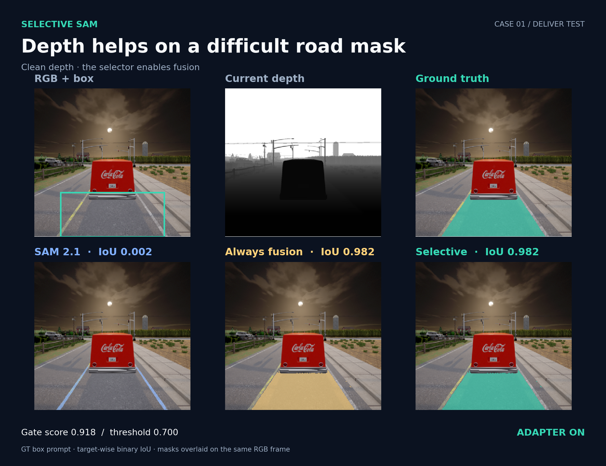
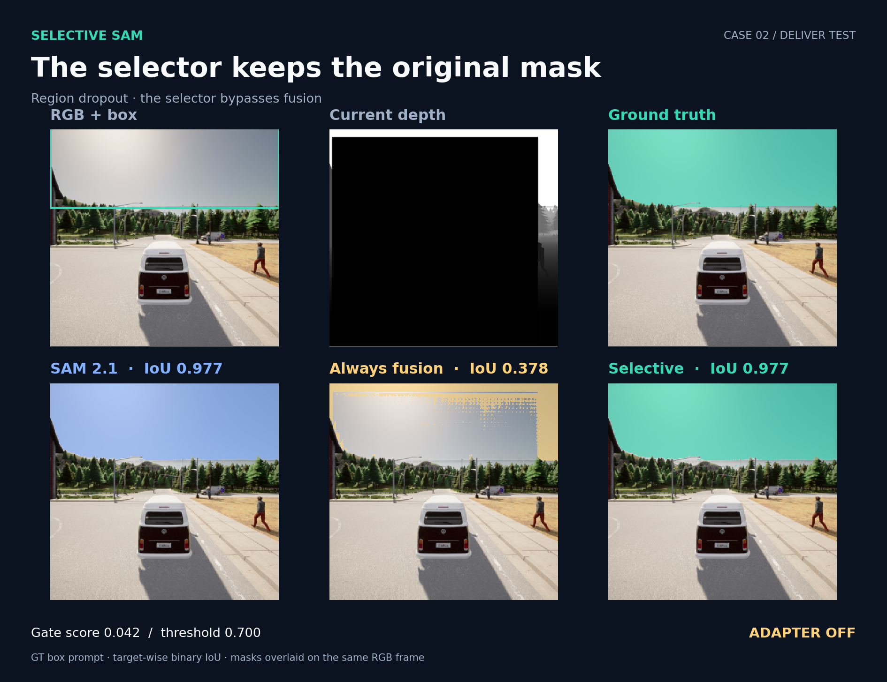

<h1 align="center">Selective SAM</h1>

<p align="center">Frozen SAM 2.1 Tiny · RGB–depth fusion · Input-aware adapter selection</p>

DeLiVER 전방 RGB와 원시 depth를 사용해 box prompt 대상 분할을 수행합니다. SAM은 고정하고 depth adapter만 학습한 뒤, 선택기가 입력마다 융합 여부를 결정합니다.



Clean depth 테스트 예시. 원본 SAM IoU 0.002 → 선택적 융합 0.982. 그림의 색상은 같은 RGB 프레임 위에 실제 예측 마스크를 표시한 것입니다.

## 결과

DeLiVER 공식 train 3,983장으로 학습하고 validation 2,005장으로 checkpoint와 선택 임계값을 정했습니다. 아래는 공식 test 1,897장의 대상별 평균 IoU입니다.

| Test depth | SAM 2.1 Tiny | 항상 융합 | 선택적 융합 |
|---|---:|---:|---:|
| 원본 | 0.7370 | 0.7907 | 0.7962 |
| 손상 | 0.7370 | 0.7663 | 0.7823 |

손상 행은 각 이미지에 배정한 잡음·픽셀 결측·영역 결측 중 하나를 depth에 적용한 결과입니다. 세 경로 모두 같은 RGB와 GT에서 만든 box prompt를 사용했습니다. 이 지표는 box prompt 이진 분할의 대상별 평균 IoU입니다.



영역 결측 테스트 예시. 항상 융합하면 IoU가 0.977에서 0.378로 떨어지지만, 선택기는 adapter를 우회해 원본 마스크를 유지합니다. 선택기는 원본 SAM 마스크도 입력으로 사용하므로 정확도 우선 구성입니다.

## 준비

| 항목 | 다운로드 | 저장 위치 |
|---|---|---|
| SAM 2 소스 | [공식 저장소](https://github.com/facebookresearch/sam2) | `third_party/sam2/` |
| SAM 2.1 Tiny | [공식 checkpoint](https://dl.fbaipublicfiles.com/segment_anything_2/092824/sam2.1_hiera_tiny.pt) | `checkpoints/sam2.1_hiera_tiny.pt` |
| DeLiVER | [공식 저장소](https://github.com/InSAI-Lab/DELIVER) · [데이터 다운로드](https://huggingface.co/datasets/InSAI-Lab/DELIVER) | `data/DELIVER/` |
| Depth adapter | [adapter_best.pt](https://github.com/singolbang/Selective_SAM/releases/download/v1.0.1/adapter_best.pt) | `checkpoints/adapter_best.pt` |
| 선택기 | [gate_best.pt](https://github.com/singolbang/Selective_SAM/releases/download/v1.0.1/gate_best.pt) | `checkpoints/gate_best.pt` |

DeLiVER에서는 `img`, `depth`, `semantic`을 사용합니다. box는 별도 제공 주석이 아니라 [`targets_from_labels()`](selective_sam/data.py)에서 semantic label의 연결 영역으로 생성합니다. 목록 생성 코드는 [`manifest.py`](selective_sam/manifest.py)에 있습니다.

Python 3.10, PyTorch 2.5.1/CUDA 12.1에서 실행했습니다. SAM 2 소스는 커밋 `2b90b9f5ceec907a1c18123530e92e794ad901a4`를 사용했습니다.

```bash
git clone https://github.com/facebookresearch/sam2.git third_party/sam2
git -C third_party/sam2 checkout 2b90b9f5ceec907a1c18123530e92e794ad901a4
pip install torch==2.5.1 torchvision==0.20.1 --index-url https://download.pytorch.org/whl/cu121
pip install -r requirements.txt
SAM2_BUILD_CUDA=0 pip install --no-deps -e third_party/sam2
```

## 추론

두 추가 가중치와 `checkpoints/selection_policy.json`을 저장한 뒤 실행합니다. 직접 준비한 이미지에는 box 좌표를 입력합니다.

```bash
python -m selective_sam.infer \
  --rgb path/to/rgb.png --depth path/to/depth.png \
  --box 100 80 400 350 --mode selective --output results/prediction.png
```

`--mode`는 `baseline`, `fusion`, `selective` 중 하나입니다. 배정된 손상 test 입력을 재현할 때는 manifest 생성 후 `--split test --index 0 --target-index 0 --damaged`를 사용합니다.

## 학습

설정은 `configs/final.yaml`과 `configs/gate_baseline.yaml`에 있습니다. SAM은 고정하며, adapter와 선택기를 같은 공식 train에서 순서대로 학습합니다.

```bash
python -m selective_sam.manifest
python -m selective_sam.train_adapter
python -m selective_sam.label_generation --split gate_train
python -m selective_sam.label_generation --split val
python -m selective_sam.train_gate_baseline
python -m selective_sam.label_generation --split test
python -m selective_sam.evaluate
```

Adapter를 다시 학습하면 해당 checkpoint로 선택기 라벨·가중치·정책도 다시 생성해야 합니다. 배포 가중치의 SHA256은 adapter `b7d437c3383dcd8e872895eb10d2847e4524a9da2ce3ff3001dd92bd22dbe82b`, 선택기 `e66a376b8570a198e540305e6efd1eef744e5b24c38718290e4a34cd9ee1df4a`입니다.
